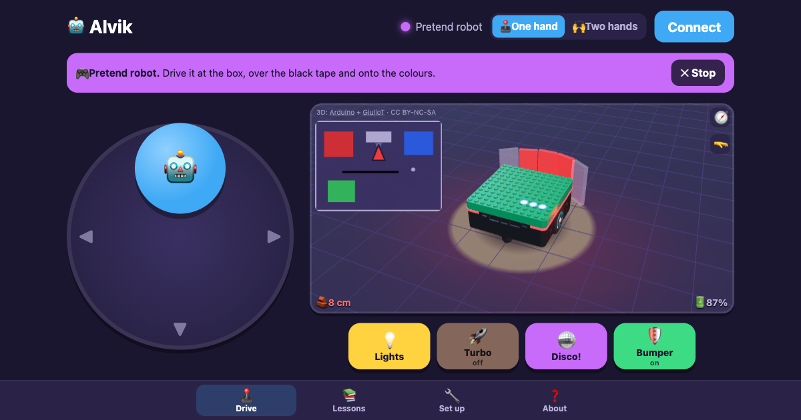

# Alvik Remote

Drive an [Arduino Alvik](https://docs.arduino.cc/hardware/alvik/) robot from a web page, and watch a
**live 3D robot** on the screen show what the real one senses: walls ahead, the colour of the floor,
a black line, being picked up.

[](https://gabeduke.github.io/alvik/?demo)

| | |
|---|---|
| 🎮 **[Try it with a pretend robot](https://gabeduke.github.io/alvik/?demo)** | No Alvik needed. Works in any browser. |
| 📚 **[Lessons](https://gabeduke.github.io/alvik/learn/)** | Nine short lessons: how it works, one sensor at a time. |
| 🔧 **[Put it on your Alvik](https://gabeduke.github.io/alvik/flash.html)** | Over USB from Chrome or Edge. Nothing to install. |
| 🤖 **[The remote](https://gabeduke.github.io/alvik/)** | Bluetooth, from a phone, tablet or laptop. |

It started as a toy for our kids' Alvik: the stock demo menu plus a phone remote. Then the robot
started sending its sensor readings back, and watching them show up on a 3D robot one at a time
turned out to be the best part. The lessons follow the same steps, so you can see it happen too.

**Who wrote the code:** [Claude](https://claude.com/claude-code), an AI, wrote nearly all of it. A parent
steers: picks what to build next, tests it on the real robot with the kids, and says what is wrong.
The point is to show children how a program works and to watch sensor data stream in live, so the
lessons explain the code in plain words; nobody here claims to have typed it. LEGO servos and Grove
sensors are next.

Everything is plain files: MicroPython on the robot, a static web page with no build tool, Web
Bluetooth to drive and Web Serial to put the code on. Not made by or connected with Arduino.

## What you get
- **A remote** with a joystick (or two thumbs), four big buttons (lights, turbo, disco dance, bumper), keyboard driving on a laptop, and an installable app that works with no wifi.
- **A live 3D robot** that turns, spins its wheels and lights up like the real one, with the distance sensor's raw readings as a cloud of dots, the bumper's decision as heat, the floor's colour, the line sensors, lift and lean.
- **A bumper** that slows the robot down near things and stops it 8 cm short, without being fooled by the floor or a shiny table.
- **A pretend robot** in a pretend room, running the same sums and speaking the same packets, for trying it all with no robot.
- **An update page** that copies the code onto the robot from the browser, and a library of extra programs ("sketches") to add to the robot's colour menu.
- **A Wio Terminal remote** (`remotes/wio_remote/`): a handheld with a stick, three buttons and a little radar screen, for driving without a phone. Not yet tried on a real Wio.
- **Lessons** for a grown-up and a child to do together.

## Quick start
You need an Alvik running MicroPython (as it comes), a USB-C cable, and Chrome or Edge.
1. On a computer, open the [update page](https://gabeduke.github.io/alvik/flash.html): 🔌 Connect USB → ⚡ Update the robot.
   This replaces the robot's stock menu program with this one (the three stock programs are still in it).
2. On the robot, tap ⬆ until the lights are **purple**, then ✓. The lights go yellow.
3. On a phone or laptop, open the [remote](https://gabeduke.github.io/alvik/), press **Connect** and pick **Alvik**.

Bluetooth works in Chrome and Edge (Android, Mac, Windows, Chromebook). On iPad and iPhone use the free **Bluefy** browser.
[Lesson 1](https://gabeduke.github.io/alvik/learn/1-wake-up.html) goes through this slowly.

## Lessons
Each is one sitting: steps to follow, how it works with the real code, experiments, and something to change.
Lessons 2 to 7 also work with the pretend robot.

| | Lesson | What comes online |
|---|---|---|
| 1 | [🔧 Wake up the robot](https://gabeduke.github.io/alvik/learn/1-wake-up.html) | the code on the robot, the colour menu |
| 2 | [🕹️ Drive it](https://gabeduke.github.io/alvik/learn/2-drive.html) | Bluetooth, and the five-byte packets |
| 3 | [🚀 Smooth moves](https://gabeduke.github.io/alvik/learn/3-smooth.html) | gentle speeding up, and stopping when the remote goes quiet |
| 4 | [📡 The robot talks back](https://gabeduke.github.io/alvik/learn/4-talks-back.html) | telemetry: the 3D robot turns, rolls and lights up |
| 5 | [👀 Seeing ahead](https://gabeduke.github.io/alvik/learn/5-seeing.html) | the distance sensor, as a cloud of dots |
| 6 | [🛡️ The bumper](https://gabeduke.github.io/alvik/learn/6-bumper.html) | from noisy readings to a decision, as heat |
| 7 | [🌈 Underneath](https://gabeduke.github.io/alvik/learn/7-underneath.html) | floor colour, line sensors, picked up, tipped |
| 8 | [🙀 Teach it a trick](https://gabeduke.github.io/alvik/learn/8-sketch.html) | your own program in the robot's menu |
| 9 | [🛠️ Make it yours](https://gabeduke.github.io/alvik/learn/9-yours.html) | your own copy of the whole project |

A lesson's link to the remote can leave sensors off the 3D robot, so they arrive one at a time:
`?show=` (none), `?show=cloud`, `?show=cloud,heat`; no `show` means everything. Add `demo` for the pretend robot.

## Layout
- `docs/` – the website
  - `index.html` – the remote; `twin.js`, `sensing.js`, `telemetry.js`, `models/alvik.glb`, `vendor/three/` – its live 3D robot
  - `pretend.js`, `bumper.js`, `playroom.js` – the pretend robot, the robot's driving sums in JavaScript, and the little map
  - `flash.html`, `flasher.js` – the 🔧 update page
  - `learn/` – the lessons (plain pages, one stylesheet)
- `src/` – the robot's own code (the "core")
  - `main.py`, `demo.py` – the colour menu (stock modes, the purple phone remote, then installed sketches)
  - `sketchbook.py` – finds the sketches installed on the robot
  - `remote_control.py` – the phone remote: Bluetooth, driving, the bumper, telemetry
  - `dance.py` – the disco dance (remote button 3 and the Disco sketch)
  - `line_follower.py`, `hand_follower.py`, `touch_move.py` – stock Arduino demos
- `sketches/<name>/` – extra programs for the menu (see [Sketches](#sketches))
- `models/` – where the 3D robot comes from: reference files, credits and the Blender script that builds `docs/models/alvik.glb`
  - `models/grove/`, `models/addons/` – parts to print for the robot's LEGO plate: trays for Grove and Modulino boards, a pen holder, a corner, a cable clip, a test stand
- `scripts/build_site.sh` – builds the Pages site into `_site/`; `tests/` – tests for both sides
- `stock-backup/` – a copy of whatever was on your robot before you changed it (not kept in git)

## Working on the code
```sh
git clone https://github.com/gabeduke/alvik && cd alvik
scripts/build_site.sh && python3 -m http.server -d _site 8000   # then open http://localhost:8000
node --test tests/*.test.mjs                                     # the page's side (Node 20+, no installs)
python3 tests/test_robot.py                                      # the robot's side, on a pretend Alvik (no installs)
```
`scripts/build_site.sh` builds `_site/` = `docs/` + `robot/*.py` (from `src/`) + `robot/index.json`
(path, size, sha256 of each) + `sketches/<name>/` (each with its own `index.json`) + `sketches/index.json`
(every sketch's `sketch.json`, checked by `scripts/sketch_index.py`), and stamps the build id into `sw.js`.
The Pages workflow (`.github/workflows/pages.yml`) runs the tests and this script, then deploys `_site/` on every push to `main`.
A fork gets its own site and its own update page: [lesson 9](https://gabeduke.github.io/alvik/learn/9-yours.html).

### The robot over USB, from a terminal
Close Arduino Lab for MicroPython first; only one program can hold the USB port.
```sh
python3 -m venv .venv && .venv/bin/pip install -r requirements.txt
alias mpr=.venv/bin/mpremote

# save the robot's original files (once) — copies every top-level file on the robot
for f in $(mpr fs ls | awk 'NR>1 && $2 !~ /\/$/ {print $2}'); do mpr fs cp :$f stock-backup/; done

mpr fs cp src/*.py : + reset    # deploy src/ and restart the robot
mpr fs mkdir :sketches; mpr fs cp -r sketches/disco :sketches/ + reset   # install a sketch by hand
mpr fs rm -r :sketches/disco    # uninstall a sketch
mpr repl                        # Python prompt on the robot (Ctrl-] to quit)
mpr fs ls                       # list files on the robot
mpr mip install github:arduino/arduino-alvik-mpy   # reinstall the Alvik library if import fails
```
If several boards are plugged in: `mpr connect /dev/cu.usbmodemXXXX ...`

### The update page
**https://gabeduke.github.io/alvik/flash.html** (or 🔧 on the remote).
Chrome or Edge on a computer, robot plugged in by USB-C, Arduino Lab for MicroPython closed.
Three steps: 🔌 Connect USB → tap **＋ Add** on any sketches (extras) you want → **⚡ Update the robot**.
Each file is written, checked (sha256 on the robot), then the robot restarts into the menu.
It flashes the files from the last push to `main`. Every flash writes all the core `src/` files (with or
without sketches), so the menu that runs sketches is always up to date.
It also rescues a stuck robot: Ctrl-C stops whatever is running first. iPad/Android can't do it.

The flasher (`docs/flasher.js`) is a dependency-free ES module that talks to MicroPython's raw REPL like
mpremote does, over any `{ write, read }` transport. `tests/fake_repl.mjs` is a pretend board for the tests.

## Driving
1. Robot on → tap the up arrow until the lights are **purple** → tap ✓ (lights go yellow).
2. Phone/tablet: **Bluefruit Connect** → connect to **Alvik** → Controller → Control Pad.
3. Arrows drive · 1 lights · 2 turbo · 3 disco dance · 4 bumper on/off. ✗ on the robot returns to the menu.

The robot speeds up gently and slows down as it gets close to things (bumper on), then stops 8 cm away. The lights blink red while it is slowing down and flash red fast once it has stopped. Tune it at the top of `src/remote_control.py` (`ACCEL`, `DECEL`, `SLOW_CM`, `BUMPER_CM`).

The distance sensor looks slightly down, so on an empty floor it sees the floor itself about 17 cm ahead, and its readings jump about. So the bumper only cares about things closer than 14 cm (`SLOW_CM`, under where the floor shows), and only once a zone has seen them in 3 new readings in a row (`SURE`, drops blips; the sensor repeats each set of readings for up to 0.3 s, and repeats don't count), and only when two of the middle three zones agree (one zone's stray reflection, on a shiny kitchen table say, does nothing). A "thing" that comes no closer while the robot drives 4 cm at it is taken for the floor (a robot tipped nose-down). Something narrow like a chair leg fills one zone only, so the robot bumps into it. The web remote shows both: the raw readings as a point cloud, and the bumper's view as the heat and the 🧱 distance. If it still slows for nothing on some floor, record that floor with `.venv/bin/python scripts/floor_log.py floor.csv` (the robot creeps 30 cm forward over USB and writes every reading to a CSV; `--still` to lift and tip it by hand instead) and lower `SLOW_CM` below what the floor reads.

## Web remote (`docs/index.html`)
**Live: https://gabeduke.github.io/alvik/**
Installable app: Chrome → Install (or Android "Add to Home screen"). It works offline. Installed copies update themselves: the build stamps the commit into `sw.js`, and the page reloads on its own (`docs/pwa.js`), but never while the robot is connected or a flash is running.
A joystick (push a little = slow, push a lot = fast), the live 3D robot, and a slim row of four buttons (Lights, Turbo, Disco, Bumper). The buttons are the same Bluetooth messages as Bluefruit; the joystick is its own message, so the robot needs the current `remote_control.py` (flash it with 🔧).
Works in Chrome/Edge (Android, laptop). iPad Safari can't do Bluetooth: open it in the free **Bluefy** app.
The 🕹️ / 🙌 switch in the header changes how you drive, and the choice is remembered on that device: **One hand** (joystick) or **Two hands** (left thumb speed, right thumb steering: good on a tablet).
Laptop keys: arrows or WASD drive, 1-4 for the buttons, Esc stops.

**New visitors.** The first time a device opens the remote, a panel says what it is and offers the pretend robot, the lessons and the update page (❓ in the footer opens it again). Until that device has connected to a real robot, a "No robot? Try a pretend one" button stays on the page. Devices that were already somebody's remote see neither. While a real robot is connected the footer's links are hidden, so a stray tap can't leave the page.

**Pretend robot** (`?demo`, or the button). `docs/pretend.js` is an Alvik in a pretend room (walls, a box, a chair leg, three coloured mats, black tape; change `ROOM` to rebuild it). It takes the page's packets and answers with the same telemetry packets, so the page treats it exactly like a robot on Bluetooth. Its ramp and bumper are the robot's own sums, copied into `docs/bumper.js`; `tests/bumper_vectors.json` holds examples with the Python's answers, and both sides are tested against it (after changing `ramp`, `bumper_limit`, `Zone` or `Bumper` in `remote_control.py`, change `bumper.js` the same way and run `WRITE_VECTORS=1 python3 tests/test_robot.py SharedSums`). What its sensors read (the floor at 16-18 cm, blips, noise) copies what the real robot was seen to do. 🫳 picks it up.

**Live 3D robot.** The page shows a 3D Alvik that copies the real one: it turns when the robot turns, its wheels spin, its light strips take the LED colours (red when the bumper stops it), and what the distance sensor reads hovers in front of it as a cloud of small points, one for every reading, floor bounce and odd readings included. What the robot's bumper makes of that glows as heat: one soft sheet across the middle three zones, gliding rather than jumping, when the bumper sees something within 14 cm (yellow at first, warmer on the way in, red from 8 cm). It leans when the real robot is tipped, and rises off the floor (leaving its shadow behind) when it is picked up. It goes by the middle of the last five readings, needs a lean of 8 degrees or a lift of 6 cm to start, and less to keep going, so a bumpy floor (wooden boards, a rug's edge) doesn't make it jump about (`poseTilt`, `poseLift` in `docs/sensing.js`). The round patch of floor under it is the colour the robot's colour sensor sees, and the three dots at its nose are the line sensors: bright over a pale floor, dark over a black line. It also shows the distance in front, the speed and the battery. It starts facing away from you; tap 🧭 when the real robot points away from you to line them up again. It takes whatever room the controls leave, on phones and tablets too. The robot sends this about 8 times a second, only when the page asks (the Bluefruit app gets nothing new), so the robot needs the current `remote_control.py` (flash it with 🔧); with older robot code the remote still drives and the 3D robot stands still. The Turbo and Bumper labels follow what the robot reports. Packet layouts (three packets: driving, the sensors in front, the sensors underneath): top of `docs/telemetry.js`. How a reading becomes a colour or a height is in `docs/sensing.js`: tune the heat, how far a lift raises the 3D robot (`FLOOR_CM`, `LIFT_HALF_CM`) and what counts as a dark line (`LINE_PALE`, `LINE_DARK`) there. To keep lag down the page draws the heading a little ahead of the last packet (`LEAD_S`). Heading comes from the wheels (`get_pose`), so it does not notice the robot being picked up and turned.
The model is Arduino's Alvik chassis with the LEGO baseplate by GiulioT (CC BY-NC-SA); see `models/README.md`. three.js is copied into `docs/vendor/` (see `docs/vendor/README.md`); there is still no bundler or install step.

## Menu colors
⬆ / ⬇ on the robot pick a program, ✓ runs it, ✗ comes back to the menu.
Order: red = touch-move · **blue = line follower (start)** · green = hand follower · purple = phone remote ·
then each installed sketch in its own colour (sorted by folder name): white = 🪩 Disco · yellow = 🐕 Follow me · cyan = 🙀 Scaredy cat.

More than 6 entries? They come in pages of 6. Page 1 is steady; on page 2 the light blinks off once every
2 seconds, on page 3 twice, and so on. If a program crashes the lights flash red 3 times and the menu comes back
(the error is printed over USB: `mpr repl`, or the flash page's Log).

## Sketches
A sketch is a small program that shows up as an extra colour in the robot's menu. Pick one on the
[flash page](https://gabeduke.github.io/alvik/flash.html) (**＋ Add**) and press **⚡ Update the robot**.

| | Sketch | Uses |
|---|---|---|
| 🪩 | [`disco`](sketches/disco/) – party lights, wiggle, big spin. ✓ dances again | wheels, lights |
| ✏️ | [`doodle`](sketches/doodle/) – draws a square, a triangle, a star or a ring with a felt pen (not run on a real robot yet) | wheels, lights, the printed [pen holder](models/addons/) |
| 🐕 | [`follow_me`](sketches/follow_me/) – follows your hand like a puppy | distance sensors, wheels, lights |
| 🙀 | [`scaredy_cat`](sketches/scaredy_cat/) – backs away when something comes close ([lesson 8](https://gabeduke.github.io/alvik/learn/8-sketch.html) writes it) | distance sensors, wheels, lights |

On the robot, a sketch lives in `/sketches/<name>/` (the same files as in this repo). At boot the menu
(`src/sketchbook.py`) lists `/sketches/`, reads each `sketch.json`, and adds a menu entry. The first time you
pick it, it adds `/sketches/<name>` to the end of `sys.path` and imports the entry module. No `__init__.py`,
no index file on the robot: delete the folder to uninstall.

### How to add a sketch
1. Make `sketches/<name>/` (`<name>` = lowercase letters, digits, `_`) with:
   - **`<name>.py`** with a `run(alvik)` function. The menu calls it over and over until ✗ is pressed;
     return a negative number to go back to the menu straight away (do this if your code waits for ✗ itself).
     Don't block for long without checking `alvik.get_touch_cancel()`.
   - **`sketch.json`**:
     ```json
     {
       "title": "Follow me",
       "emoji": "🐕",
       "description": "One line for the card on the flash page.",
       "color": [1, 1, 0],
       "hardware": ["distance sensors", "wheels", "lights"],
       "entry": "follow_me"
     }
     ```
     `color` is the menu light, each of red, green, blue 0 or 1 (all seven are in use now; reuse is fine,
     best on another page). `entry` is the module to import; its name must not match a file in `src/` or another
     sketch's entry (the build checks this).
   - **`README.md`**: what it does, its lights and buttons, which sensors it uses.
2. More files? Put them in the same folder and `import` them by name (keep the names unique). Shared code can
   go in `src/` (like `dance.py`); flashing a sketch always flashes `src/` too.
3. Test: `python3 tests/test_robot.py` and `node --test tests/*.test.mjs`, or copy it onto the robot with
   mpremote (see [The robot over USB](#the-robot-over-usb-from-a-terminal)). Push to `main` and it appears on the flash page about a minute later.

## Ideas / next
Sketch ideas waiting for hardware (#3): 🦾 claw + catapult (servos), 👀 eyes (OLED).
- Servos (Geekservo 9g 270°) on servo A/B → claw + catapult buttons (`alvik.set_servo_positions(a, b)`) (#7)
- Grove sensors on the Alvik's Grove ports, sent to the page as a new packet and shown on the 3D robot
- Xbox Wireless Controller (model 1914) via Bluepad32 (needs Arduino C++, not MicroPython)
- Eyes on the Qwiic port (uses `alvik.i2c`): Adafruit 1.3" 128x64 OLED STEMMA QT (#938) showing moods — happy driving, scared at the bumper, dizzy after a spin, sleepy when idle, angry when picked up

## Credits and licences
- The code is MIT ([`LICENSE`](LICENSE)), apart from the files below. It was written by Claude (Anthropic's AI) with a parent directing.
- The 3D robot is built from Arduino's published Alvik chassis model and the
  ["Arduino Alvik top baseplate (LEGO/DUPLO versions)"](https://makerworld.com/en/models/1298936) by GiulioT,
  which is CC BY-NC-SA. So `docs/models/alvik.glb` is CC BY-NC-SA too: keep the credit, don't sell it. Details: `models/README.md`.
- `line_follower.py`, `hand_follower.py`, `touch_move.py` and the bones of the menu come from Arduino's
  [arduino-alvik-mpy](https://github.com/arduino/arduino-alvik-mpy) examples (MPL-2.0).
- [three.js](https://threejs.org/) (MIT) is in `docs/vendor/three/`.
- The button packets are the Control Pad format of Adafruit's Bluefruit Connect app.

Found a mistake, or built something with it? [Open an issue](https://github.com/gabeduke/alvik/issues).
