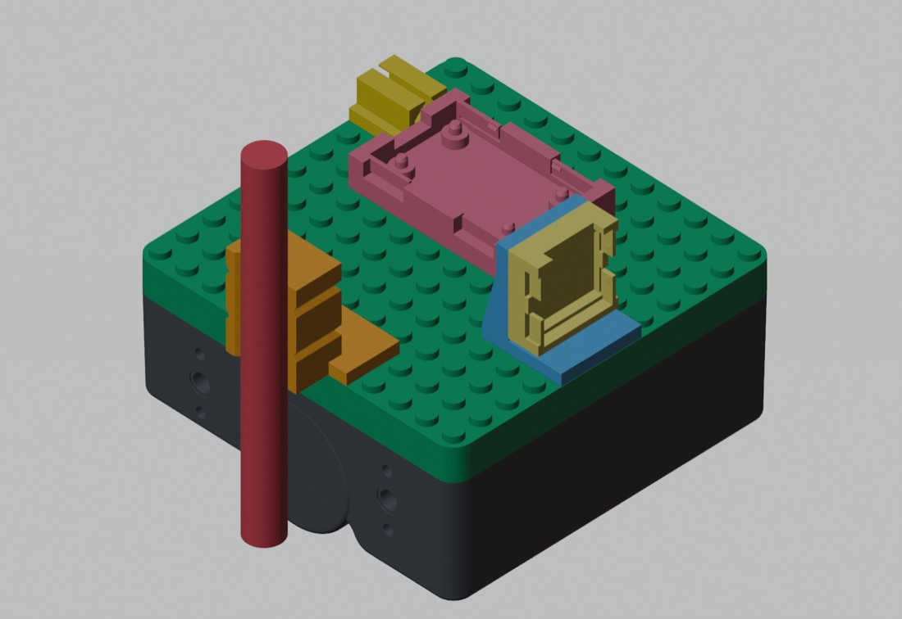
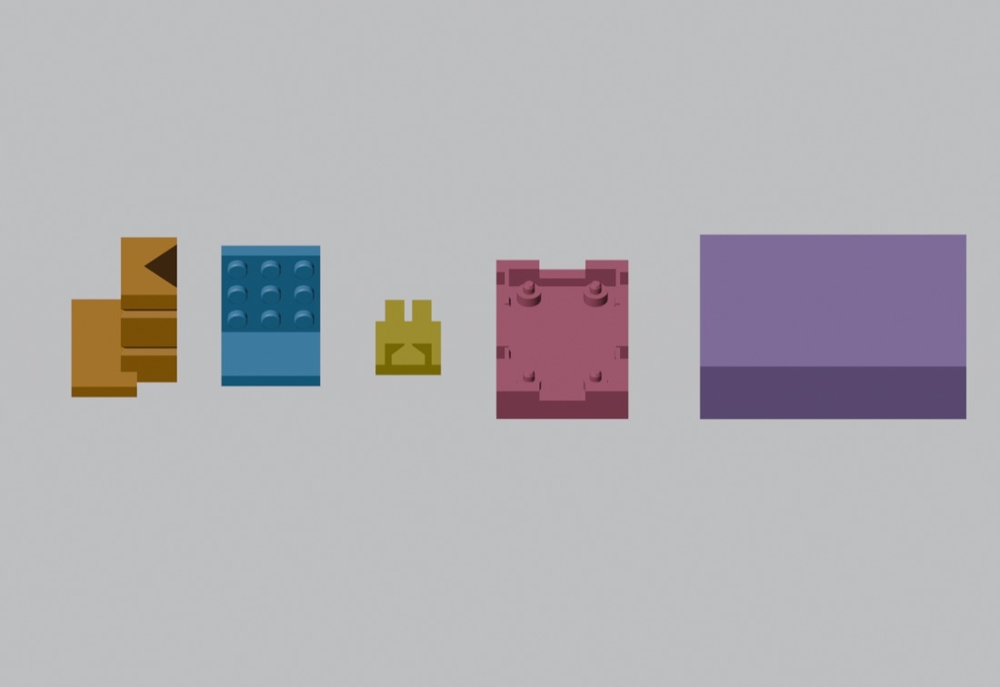

# Add-ons that go with the Grove holders

More printable parts for the robot's LEGO plate. They use the same LEGO underside as the Grove trays
in `../grove/`, so one fit test covers both. Units are millimetres.



**Not printed yet.** The shapes are checked in Blender (closed solids, on the stud grid, placed on
Arduino's chassis file). How they fit, hold and print is still a guess. Print `../grove/fit_test_2x2.stl`
first.

| File | What it is for | Size | Studs |
|---|---|---|---|
| `pen_holder.stl` | Holds a felt pen beside the right wheel, so the robot draws | 25.4 x 31.8 x 28 | 2 x 4 |
| `corner_3x3.stl` | A wall with studs on its front, so a Grove tray can face forward | 23.8 x 23.8 x 27.9 | 3 x 3 |
| `cable_clip_2x2.stl` | Keeps wires out of the wheels | 15.8 x 15.8 x 10.2 | 2 x 2 |
| `modulino_tray.stl` | A tray for one Arduino Modulino board | 31.8 x 47.8 x 9 | 4 x 6 |
| `test_stand.stl` | The robot sits on it with its wheels in the air | 64 x 48 x 17 | none |



They are built by `../build_addons.py`, not edited by hand:

```sh
/Applications/Blender.app/Contents/MacOS/Blender -b --python models/build_addons.py
```

## Pen holder

Press it onto the two outside rows of studs on the robot's right side, in the middle, so it sits over
the wheel. (The right side is on your right when you look the same way as the robot.) The tower hangs
over the plate's edge. Stand a felt pen in the V, tip on the paper, and stretch a rubber band round
the pen and the tower at each groove.

- It takes pens from about 8 to 19 mm across. Take the cap off first.
- The pen's tip is on the line between the two wheels. That is what lets the robot turn a sharp
  corner: see the [Doodle sketch](../../sketches/doodle/).
- How far the tip is from the middle of the robot depends on the pen: 49.5 mm plus 0.71 x the pen's
  width. An 8 mm pen is 5.5 cm out, 10 mm is 5.7, 12 mm is 5.8, 15 mm is 6.0, 18 mm is 6.2. The sketch
  wants this number (`PEN_CM`).
- It fits the left side too, turned round. The sketch then needs its turns the other way.
- Not known: whether the real wheel sticks out past the plate. On Arduino's chassis file it does not,
  and the pen then clears the body by about 3 mm.

## Corner

A tray on the plate looks at the ceiling. This is for boards that have to look ahead: a distance
sensor, a camera, a light sensor. Press a Grove tray onto the nine studs on the wall, then press the
corner onto the plate. A 20 x 20 tray clears the foot by 0.7 mm.

- Hold the wall from behind while you press a tray on, so the push does not bend it. Three braces
  behind the wall help.
- The nine wall studs print lying on their side and come out a little rough underneath. They start
  0.1 mm thinner than the others for that (`SIDE_STUD_D`). Too tight or too loose: change it.

## Cable clip

Press it onto the plate where a wire goes past. Push the wires down through the slit one at a time.
The channel is 8 mm wide and 3 mm high under a sloped roof; the slit is 1.8 mm. Not tried with a
real Grove or Qwiic cable.

## Modulino tray

For Arduino's Modulino boards (Buzzer, Pixels, Buttons, Knob, Distance, Movement, Thermo and the
others: they are all the same size). The board sits on four posts with a peg through each of its
holes. Four clips on springy pieces of the side walls hold it down, as on the Grove trays. Both end
walls are low in the middle for the Qwiic plugs.

- Numbers from Arduino's datasheets (for example
  [the Buzzer's](https://docs.arduino.cc/resources/datasheets/ABX00108-datasheet.pdf), "Mechanical
  Information"): board 41 x 25.36 x 1.6 mm, four 3.2 mm holes 32 mm apart along it and 16 mm across,
  a Qwiic socket in the middle of each short end. No Modulino has been in this tray.
- The clips reach 0.45 mm over the board's long edges. Arduino's drawings do not say what is that
  close to the edge on each board: look before you push.
- Does a Modulino work on the Alvik? Arduino's manual does not show one. Arduino's own library has
  an example that lights a Modulino Pixels from the robot:
  [`examples/communication/modulino.py`](https://github.com/arduino/arduino-alvik-mpy/blob/main/examples/communication/modulino.py).
  Not tried here.

## Test stand

Put the robot on it and the wheels hang 7 mm above the table. Now a program can spin the wheels
while the robot stays on your desk with its USB cable in. Good for trying a new sketch, and for
watching what the wheels do.

- It goes under the flat middle of the belly, between the wheels. Either way round.
- The belly's shape is from Arduino's chassis file (flat and 10.1 mm above the table from 30 mm
  behind the wheels' middle to 30 mm in front, 36 mm to each side). The real robot's belly was not
  measured: check that nothing sits on a screw or a sensor.
- A sketch that waits for something in front of the robot, or for a line under it, will see
  different things up here.

## Printing

- Print each file the way up it comes: no supports. The stand is stored upside down (its flat top on
  the bed). 0.2 mm layers or finer, 3 walls.
- The pen holder, corner, clip and tray touch the bed mostly along a thin rim, like the Grove trays:
  wash the plate and add a 5 mm outer brim.
- Too tight or too loose on the studs: change `FIT` in `../build_grove_holders.py`, then build both
  scripts again.

## More ideas, not built

In the order they seem worth doing:

1. **A servo to lift the pen**, so the robot can stop drawing between shapes. Waits for the servos
   in issue #7.
2. **A stand-up holder for the eyes** (issue #8): the SparkFun Qwiic OLED 1.3 in is not a square
   board (36.8 mm across its four ears, holes 30.48 x 31.75 mm apart, from SparkFun's board file),
   so it needs its own plate for the corner's wall.
3. **A tray for 1 x 1 inch Qwiic boards**: 25.4 mm square, four 3.3 mm holes 20.32 mm apart (from
   one SparkFun board's file, not from a written standard).
4. **A tray for a mini breadboard**, for a small microcontroller board riding on top. Mini
   breadboards differ by a millimetre or two between makers: measure yours first.
5. **A tilted corner**, so a camera looks a little down at the floor ahead.
6. **A box for the kit**: one place for the boards, cables and spare trays.

## Licence

Made in this repo from the numbers above; MIT like the rest of the code.
